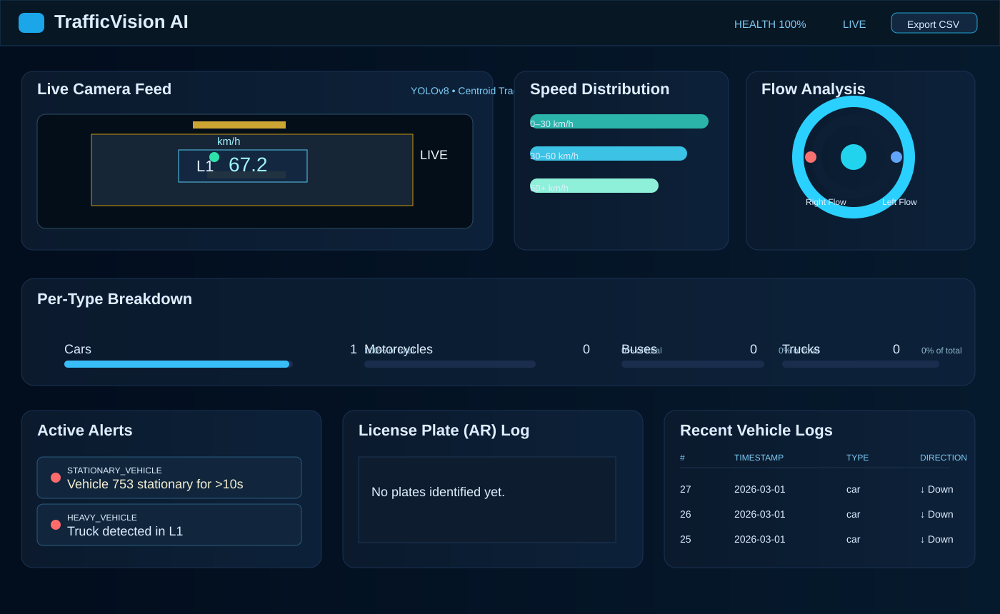
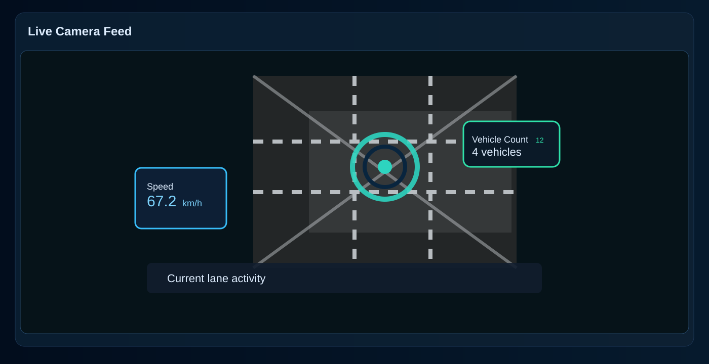
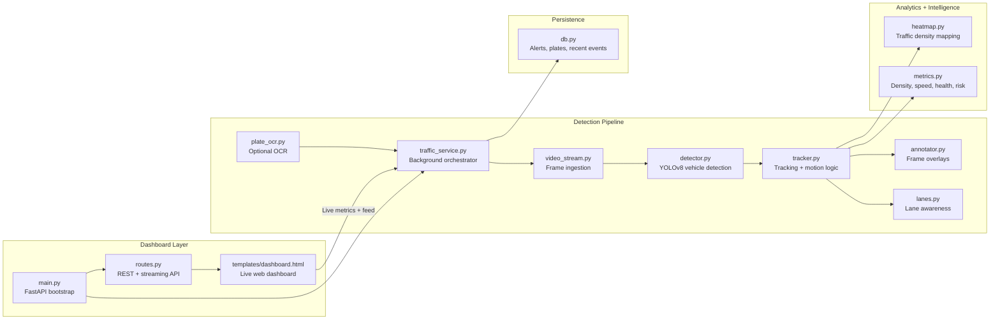

# Traffic Vision Analytics

A real-time traffic analytics dashboard for vehicle counting, speed monitoring, lane flow analysis, and alerting. The app uses a YOLO-based detector, centroid tracking, speed estimation, and a FastAPI dashboard front-end to show live performance metrics and recent traffic events.

## Live status

The application was verified running on localhost and responding successfully with `HTTP 200` on the health endpoint.

- App URL: http://localhost:8000/
- Health URL: http://localhost:8000/healthz

## Documentation

- [Main overview](README.md)
- [Challenges faced and resolutions](docs/CHALLENGES.md)
- [Deployment and setup guide](docs/DEPLOYMENT.md)
- [Project roadmap and future improvements](docs/ROADMAP.md)

## Screenshots





## Quick start

1. Create or activate a Python environment.
2. Install dependencies:

```powershell
python -m pip install -r requirements.txt
```

3. Start the service:

```powershell
python main.py
```

4. Open:

```text
http://localhost:8000/
```

## Working tree

```text
traffic_analysis-main/
├── .dockerignore
├── Dockerfile
├── README.md
├── requirements.txt
├── annotator.py
├── benchmark.py
├── config.py
├── db.py
├── detector.py
├── diag.py
├── heatmap.py
├── lanes.py
├── main.py
├── metrics.py
├── plate_ocr.py
├── routes.py
├── traffic.db
├── traffic.mp4
├── traffic_service.py
├── tracker.py
├── video_stream.py
├── yolov8n.pt
├── templates/
│   └── dashboard.html
├── uploads/
│   └── (uploaded source videos)
├── traffic_ai/
│   ├── main.py
│   ├── requirements.txt
│   ├── templates/
│   │   └── dashboard.html
│   └── app/
│       ├── __init__.py
│       ├── config.py
│       ├── analytics/
│       │   ├── __init__.py
│       │   └── metrics.py
│       ├── api/
│       │   ├── __init__.py
│       │   └── routes.py
│       ├── database/
│       │   ├── __init__.py
│       │   └── db.py
│       ├── detection/
│       │   ├── __init__.py
│       │   └── detector.py
│       ├── ingestion/
│       │   ├── __init__.py
│       │   └── video_stream.py
│       ├── services/
│       │   ├── __init__.py
│       │   └── traffic_service.py
│       └── tracking/
│           ├── __init__.py
│           └── tracker.py
└── __pycache__/
```

## Internal structure blueprint



## Key modules

- `main.py` – Starts the FastAPI app, serves the dashboard, and boots the background pipeline.
- `traffic_service.py` – Maintains shared state, manages the worker thread, and coordinates detection, tracking, logs, and UI metrics.
- `routes.py` – Exposes `/health`, `/stats`, `/vehicles`, `/alerts`, `/upload`, `/switch_camera`, and `/video_feed` APIs.
- `detector.py` – Loads the YOLOv8 model and returns vehicle detections with confidence and class names.
- `tracker.py` – Tracks objects across frames and computes movement, lane placement, speed, and motion direction.
- `metrics.py` – Aggregates density, hourly totals, health score, speed buckets, and risk calculations.
- `db.py` – Stores recent vehicle events, alerts, and OCR plate reads for dashboard queries.
- `annotator.py` – Draws bounding boxes, lane lines, counts, and overlays on the live frame.
- `video_stream.py` – Supplies frames from the configured video source or webcam.
- `config.py` – Central configuration for camera source, model path, thresholds, and traffic parameters.
- `plate_ocr.py` – Recognizes plates when OCR is enabled.
- `templates/dashboard.html` – Browser dashboard UI for the traffic view.

## Functional overview

The system performs the following steps in real time:

1. Reads frames from the configured source.
2. Detects vehicle candidates with YOLOv8.
3. Tracks each object across frames using centroid-based motion tracking.
4. Computes lane-wise counts, speed buckets, and violation flags.
5. Updates the live dashboard and recent event log.
6. Supports optional OCR for plate reads and heatmap generation for density analysis.

## Typical traffic signals tracked

- Vehicle counts and throughput
- Lane occupancy by direction
- Speed violations by band: 0–30, 30–60, 60+
- Wrong-way movement alerts
- Stationary vehicle alerts
- Heavy vehicle tagging
- Plate OCR events
- Real-time risk and health scoring

## Notes

- The project includes both a root-level FastAPI application and a nested `traffic_ai/` package with a modular app structure.
- The current runtime was validated successfully using Python 3.14 in the workspace environment.
- For local use, ensure the `traffic.mp4` file or uploaded video is available before launching the detection pipeline.
